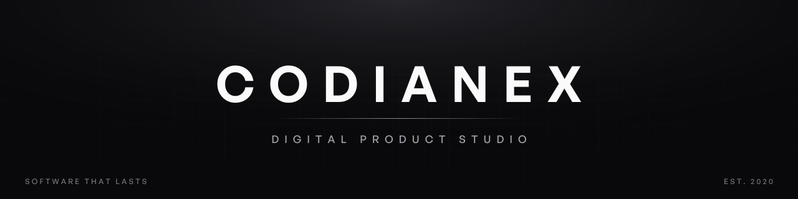

### Software that lasts, companies that trust us.

[Website](https://codianex.com) · [Services](https://codianex.com/#services) · [About](https://codianex.com/#about) · [Blog](https://codianex.com/blog) · [Contact](https://codianex.com/#contact) · [hello@codianex.com](mailto:hello@codianex.com)

---

Codianex is a **digital product studio** founded on a simple belief: exceptional software is the result of deep craft, not just fast execution. We work with founders, enterprises and ambitious teams to design and engineer products people love — from early-stage MVPs to large-scale platform rebuilds. **We don't disappear after launch.**

## What we build

| | |
|---|---|
| **Web development** | Production-grade web applications with React, Next.js and modern APIs — from MVPs to enterprise platforms. |
| **Mobile applications** | Cross-platform and native apps for iOS and Android, built for performance and polish. |
| **UI/UX design** | User-centered design grounded in psychology and data: less friction, more trust. |
| **Backend & APIs** | Reliable, scalable server-side systems: REST, GraphQL and microservices. |
| **SEO & analytics** | Data-driven growth: organic visibility, qualified traffic and better product decisions. |
| **Security & DevOps** | CI/CD, cloud architecture and monitoring, so you can ship with confidence. |

## How we work

- **Craft over velocity** — we move fast but never sacrifice quality. Every detail is intentional.
- **Transparency always** — no black boxes. You own your code, your data, your decisions.
- **Long-term thinking** — we design for the product you'll have in three years, not just today.

A focused MVP typically ships in **6–10 weeks**; a full-featured product in **3–6 months**, with milestones defined upfront. Launch is the beginning of the relationship: we offer retainers for maintenance, monitoring and iteration, and we can join your team as an embedded partner.

## Our toolbox

## By the numbers

**50+** projects shipped · **12** countries served · **6** years in business · **98%** client retention

## Let's build something remarkable

Have a project in mind? **[Start a conversation →](https://codianex.com/#contact)** or write to **hello@codianex.com** — we reply within 24 hours.

<b>🇪🇸 Español</b>

 

**Codianex** es un estudio de producto digital fundado sobre una idea simple: el software excepcional nace del oficio, no solo de la velocidad. Trabajamos con fundadores, empresas y equipos ambiciosos para diseñar y construir productos que la gente ama, desde MVPs hasta reconstrucciones de plataformas completas. **No desaparecemos después del lanzamiento.**

**Qué construimos:** desarrollo web · aplicaciones móviles · diseño UI/UX · backend y APIs · SEO y analítica · seguridad y DevOps.

**Cómo trabajamos:** oficio por encima de la velocidad · transparencia siempre (tu código, tus datos, tus decisiones) · pensamiento a largo plazo.

**En números:** 50+ proyectos · 12 países · 6 años · 98 % de retención de clientes.

¿Tienes un proyecto en mente? Escríbenos a **hello@codianex.com** y te respondemos en menos de 24 horas.

